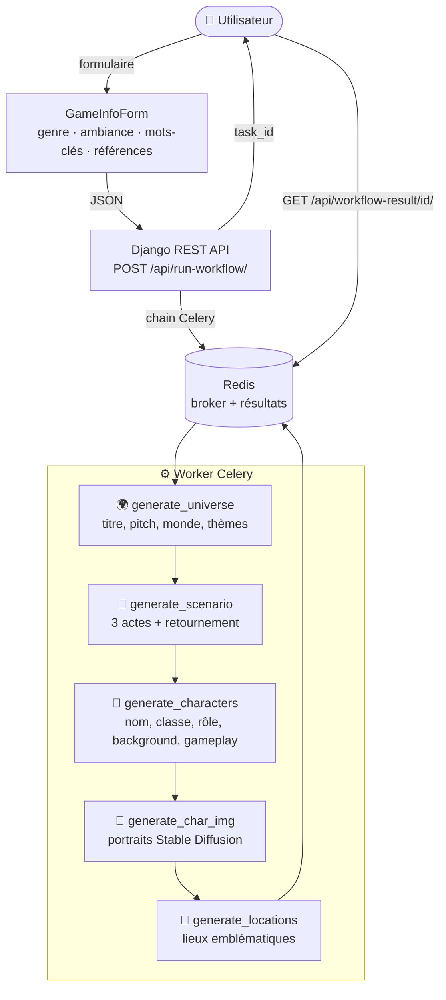

<div align="center">

# 🎮 GameForge

**Générateur de concepts de jeux vidéo par IA**

Décris ton jeu, et GameForge s'occupe du reste : univers, scénario en 3 actes, personnages, portraits et lieux emblématiques.


[Présentation](#-présentation) · [Flux de données](#-flux-de-données) · [Installation](#-installation) · [API](#-api) · [Modèles](#-modèles-utilisés) · [Avancement](#-avancement)

</div>

---

## 📖 Présentation

GameForge est une plateforme web Django qui génère des concepts de jeux vidéo originaux à l'aide de modèles d'IA **Hugging Face**.

L'utilisateur choisit quatre éléments :

| Champ | Options |
|---|---|
| 🎯 Genre | RPG, FPS, Metroidvania, Visual Novel |
| 🌫 Ambiance | Post-apo, Guerre, Cyberpunk, Dark fantasy |
| 🔑 Mots-clés | *boucle temporelle, vengeance, IA rebelle…* |
| 📚 Références *(facultatif)* | *Zelda, Hollow Knight, Disco Elysium…* |

À partir de ces choix, une chaîne de tâches **Celery asynchrones** produit étape par étape un concept de jeu complet, au format JSON.

---

## 🔄 Flux de données



Chaque étape reçoit la sortie de la précédente. Le client récupère le résultat final en interrogeant l'endpoint de résultat avec le `task_id` reçu au lancement.

---

## 🛠 Installation

### Prérequis

- Python 3.11 ou plus (développé en 3.13)
- Redis, utilisé comme broker Celery
- Node.js, pour le frontend React
- *(Optionnel)* Un GPU CUDA, pour accélérer Stable Diffusion

### 1. Cloner et créer l'environnement

```bash
git clone https://github.com/SPLEENINJA/GameForge.git
cd GameForge
python -m venv .venv
source .venv/bin/activate          # Windows : .venv\Scripts\activate
```

### 2. Installer les dépendances

```bash
pip install django djangorestframework celery redis \
            transformers torch accelerate diffusers requests
```

### 3. Créer la base de données

```bash
python manage.py migrate
python manage.py createsuperuser   # optionnel, pour /admin
```

### 4. Lancer les services

Ouvre trois terminaux :

```bash
# Terminal 1 : Redis
docker run -p 6379:6379 redis
# (ou redis-server si Redis est installé localement)

# Terminal 2 : worker Celery
celery -A GameForge worker -l info
# Sur Windows : ajouter --pool=solo

# Terminal 3 : serveur Django
python manage.py runserver
```

Le formulaire est accessible sur **http://127.0.0.1:8000/api/form/**.

### 5. Frontend (optionnel)

```bash
cd frontend
npm install
npm start          # http://localhost:3000
```

### Variables d'environnement

| Variable | Usage |
|---|---|
| `HF_API_TOKEN` | Token Hugging Face pour la génération d'images via l'Inference API. Il n'est utilisé que si Stable Diffusion ne peut pas tourner en local. |

---

## 🔌 API

Toutes les routes sont préfixées par `/api/`.

| Méthode | Route | Entrée | Sortie |
|---|---|---|---|
| `POST` | `run-workflow/` | JSON du formulaire | `task_id` du pipeline complet |
| `GET` | `workflow-result/<task_id>/` | – | JSON final ou `{"status": "pending"}` |
| `POST` | `generate-universe/` | JSON du formulaire | `task_id` |
| `POST` | `generate-scenario/` | JSON de l'univers | `task_id` |
| `POST` | `generate-characters/` | JSON du scénario | `task_id` |
| `POST` | `generate-char-images/` | JSON des personnages | `task_id` |
| `POST` | `generate-locations/` | JSON du scénario | `task_id` |
| `GET` | `task-result/<task_id>/` | – | Résultat d'une tâche |
| `GET`/`POST` | `form/` | Formulaire HTML | JSON utilisateur |

### Exemple

```bash
curl -X POST http://127.0.0.1:8000/api/run-workflow/ \
  -H "Content-Type: application/json" \
  -d '{
    "genre": "Metroidvania",
    "ambiance": "Dark fantasy",
    "mots_cles": ["boucle temporelle", "vengeance"],
    "references": ["Hollow Knight"]
  }'
# → {"task_id": "3f2a..."}

curl http://127.0.0.1:8000/api/workflow-result/3f2a.../
```

---

## 🤖 Modèles utilisés

| Étape | Modèle | Type |
|---|---|---|
| Univers, scénario, personnages, lieux | [`distilbert/distilgpt2`](https://huggingface.co/distilbert/distilgpt2) | Génération de texte (`transformers`) |
| Portraits de personnages | [`runwayml/stable-diffusion-v1-5`](https://huggingface.co/runwayml/stable-diffusion-v1-5) | Text-to-image (`diffusers`), avec repli sur l'Inference API |

`distilgpt2` a été choisi pour sa légèreté : il tourne sur CPU. En contrepartie, il suit mal les consignes de format et produit rarement un JSON valide. Dans ce cas, la tâche renvoie `{"error": "JSON invalide", "raw_output": ...}`. Un modèle instruct plus capable (Mistral-7B-Instruct, Qwen2.5-Instruct…) améliorerait nettement la qualité.

---

## 📁 Structure du projet

```
GameForge/
├── manage.py
├── GameForge/              # Configuration Django
│   ├── settings.py         # Celery + Redis configurés ici
│   ├── celery.py           # Application Celery
│   └── urls.py
├── api/                    # Application principale
│   ├── forms.py            # GameInfoForm → JSON
│   ├── views.py            # Endpoints REST
│   ├── urls.py
│   └── templates/api/game_info.html
├── tasks/                  # Tâches Celery (IA)
│   ├── generate_universe.py
│   ├── generate_scenario.py
│   ├── generate_characters.py
│   ├── generate_char_img.py
│   ├── generate_locations.py
│   └── tasks_workflow.py   # Chaîne complète
└── frontend/               # React (Create React App)
```

---

## 📸 Screenshots

> *À compléter : formulaire, résultat JSON, portraits générés.*

---

## ✅ Avancement

### Implémenté

- [x] Formulaire de création guidée (genre, ambiance, mots-clés, références)
- [x] API REST avec Django REST Framework
- [x] Génération asynchrone avec Celery et Redis
- [x] Pipeline chaîné : univers → scénario → personnages → images → lieux
- [x] Endpoints unitaires pour chaque étape, plus un endpoint de suivi de tâche
- [x] Génération d'images Stable Diffusion, en local ou via l'API Hugging Face
- [x] Initialisation de la page d'accueil React

### Non implémenté

- [ ] Authentification (inscription, connexion, déconnexion)
- [ ] Sauvegarde des jeux en base (aucun modèle Django)
- [ ] Pages d'accueil publique, tableau de bord, détail et favoris
- [ ] Projets publics ou privés
- [ ] Limitation d'usage de l'API par utilisateur
- [ ] Mode « exploration libre » (génération aléatoire)
- [ ] Illustrations d'environnements
- [ ] Fiche de présentation / pitch deck
- [ ] Bonus : export PDF, recherche, narration dynamique, GDD
